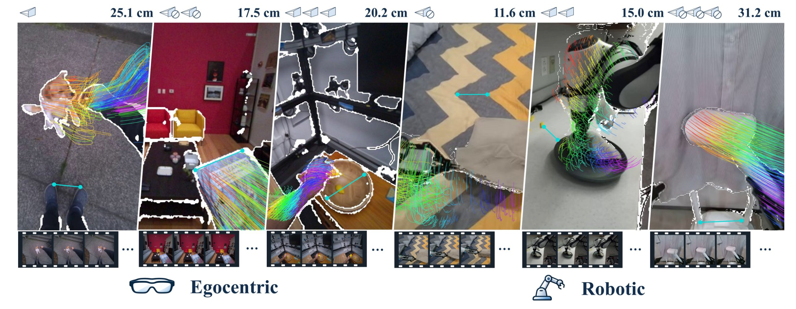

<h1>SCALE4D</h1>
<h3>Metric 4D Modeling for Embodied Perception</h3>

  <a href="https://lsn33096.github.io/index.html">Di Liu</a>1 &nbsp;·&nbsp; <a href="https://xuweiyichen.github.io/">Xuweiyi Chen</a>1,2 &nbsp;·&nbsp; <a href="https://scholar.google.com/citations?user=c_o9GhsAAAAJ&amp;hl=en&amp;oi=ao">Cheng Zhang</a>1 &nbsp;·&nbsp; <a href="https://adamharley.com/">Adam Harley</a>1  
  <a href="https://flycooler.com/">Zhao Dong</a>1 &nbsp;·&nbsp; <a href="https://tschmidt23.github.io/">Tanner Schmidt</a>1 &nbsp;·&nbsp; <a href="https://scholar.google.com/citations?user=EcUN5MQAAAAJ&amp;hl=en&amp;oi=ao">David Caruso</a>1 &nbsp;·&nbsp; <a href="https://scholar.google.com/citations?user=8u1nmVUAAAAJ&amp;hl=en&amp;oi=sra">Pierre Moulon</a>1  
  <a href="https://shugaoma.github.io/">Shugao Ma</a>1 &nbsp;·&nbsp; <a href="https://www.cs.virginia.edu/~zc3bp/index.html">Zezhou Cheng</a>2 &nbsp;·&nbsp; <a href="https://scholar.google.com/citations?user=MhowvPkAAAAJ&amp;hl=en&amp;oi=ao">Richard Newcombe</a>1 &nbsp;·&nbsp; <a href="https://jakobengel.github.io/">Jakob Julian Engel</a>1

1Reality Labs Research, Meta &nbsp;·&nbsp; 2University of Virginia

  <a href="https://facebookresearch.github.io/rlr_scale4d/"><strong>Project Page</strong></a>
  &nbsp;·&nbsp;
  <a href="https://huggingface.co/facebook/SCALE4D"><strong>Benchmark</strong></a>

## Updates

- **Code and model weights are under final legal review and will be released once the review is complete.**

## Overview

SCALE4D models metric 4D geometry and motion from single- or multi-view video,
with optional camera poses. Visit the [project page](https://facebookresearch.github.io/rlr_scale4d/)
for interactive visualizations and the [Benchmark](https://huggingface.co/facebook/SCALE4D)
for supplementary examples and data.

## Contributing

See [CONTRIBUTING.md](CONTRIBUTING.md) for contribution guidelines and
[CODE_OF_CONDUCT.md](CODE_OF_CONDUCT.md) for our community standards.

## License

The majority of SCALE4D is licensed under CC-BY-NC 4.0, however portions of the
project are available under separate license terms: VideoMAE V2 is licensed
under the MIT license; three.js, used by the project website, is also licensed
under the MIT license.

See [LICENSE](LICENSE) for the SCALE4D license and
[THIRD_PARTY_NOTICES.md](THIRD_PARTY_NOTICES.md) for third party attribution and
license details.

Copyright (c) Meta Platforms, Inc. and affiliates.
