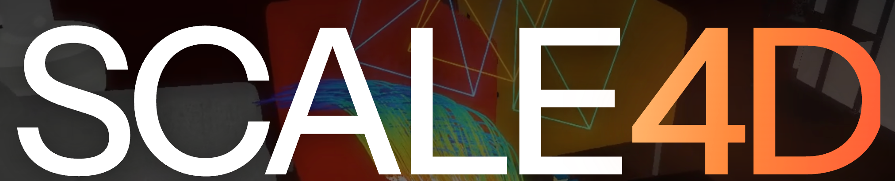

<h3>Metric 4D Modeling for Embodied Perception</h3>

  <a href="https://lsn33096.github.io/index.html">Di Liu</a> &nbsp;·&nbsp; <a href="https://xuweiyichen.github.io/">Xuweiyi Chen</a> &nbsp;·&nbsp; <a href="https://scholar.google.com/citations?user=c_o9GhsAAAAJ&amp;hl=en&amp;oi=ao">Cheng Zhang</a> &nbsp;·&nbsp; <a href="https://adamharley.com/">Adam Harley</a>  
  <a href="https://flycooler.com/">Zhao Dong</a> &nbsp;·&nbsp; <a href="https://tschmidt23.github.io/">Tanner Schmidt</a> &nbsp;·&nbsp; <a href="https://scholar.google.com/citations?user=EcUN5MQAAAAJ&amp;hl=en&amp;oi=ao">David Caruso</a> &nbsp;·&nbsp; <a href="https://scholar.google.com/citations?user=8u1nmVUAAAAJ&amp;hl=en&amp;oi=sra">Pierre Moulon</a>  
  <a href="https://shugaoma.github.io/">Shugao Ma</a> &nbsp;·&nbsp; <a href="https://www.cs.virginia.edu/~zc3bp/index.html">Zezhou Cheng</a> &nbsp;·&nbsp; <a href="https://scholar.google.com/citations?user=MhowvPkAAAAJ&amp;hl=en&amp;oi=ao">Richard Newcombe</a> &nbsp;·&nbsp; <a href="https://jakobengel.github.io/">Jakob Julian Engel</a>

 Reality Labs Research, Meta &nbsp;·&nbsp;  University of Virginia

  <a href="https://facebookresearch.github.io/rlr_scale4d/"><strong>Project Page</strong></a>
  &nbsp;·&nbsp;
  <a href="https://facebookresearch.github.io/rlr_scale4d/scale4d.pdf"><strong>Technical Report</strong></a>
  &nbsp;·&nbsp;
  <a title="Paper publication pending"><strong>Paper</strong></a>
  &nbsp;·&nbsp;
  <a href="https://facebookresearch.github.io/rlr_scale4d/demo.html"><strong>Demo</strong></a>
  &nbsp;·&nbsp;
  <a href="https://huggingface.co/facebook/SCALE4D" title="Model weights are under final legal review"><strong>Checkpoints</strong></a>

## Updates

- **Code and model weights are under final legal review and will be released very soon.**

## Overview

Metric 3D geometry and motion are essential for embodied reasoning.
Yet existing feedforward 4D models underuse synchronized views and calibrated
cameras available to embodied systems. We introduce **SCALE4D**, a unified
feedforward model that predicts metric 3D geometry and trajectories from single-
or multiview videos, with optional camera conditioning.

## Contributing

See [CONTRIBUTING.md](CONTRIBUTING.md) for contribution guidelines and
[CODE_OF_CONDUCT.md](CODE_OF_CONDUCT.md) for our community standards.

## License

The majority of SCALE4D is licensed under CC-BY-NC 4.0, however portions of the
project are available under separate license terms: VideoMAE V2 is licensed
under the MIT license; three.js, used by the project website, is also licensed
under the MIT license.

See [LICENSE](LICENSE) for the SCALE4D license and
[THIRD_PARTY_NOTICES.md](THIRD_PARTY_NOTICES.md) for third party attribution and
license details.

Copyright (c) Meta Platforms, Inc. and affiliates.
